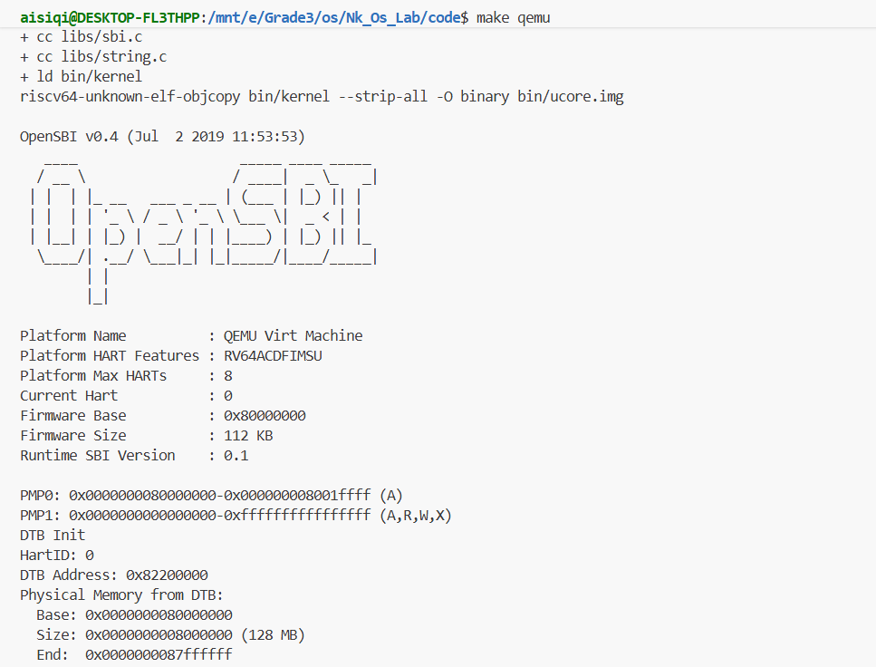
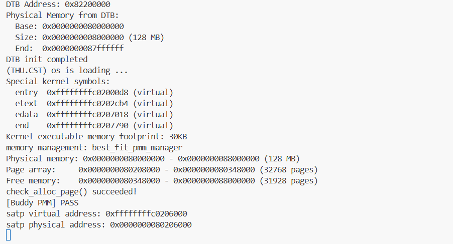
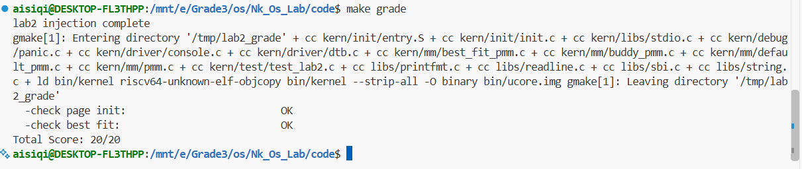

# 操作系统实验报告

## 实验基本信息

| 项目 | 内容 |
|------|------|
| **实验名称** | Lab 2: [物理页表和内存] |
| **小组成员** | 2410796-艾思奇、2412806-阳雨洁 |
| **完成日期** | 2026-10-23 |

### 小组分工

练习如何分工？

| 成员 | 负责的练习/模块 |
|------|----------------|
| 2410796-艾思奇 | [模块二任务二，三] |
| 2412806-阳雨洁 | [模块一，模块二任务一] |


---

## 一、实验目的

<!-- 说明本次实验的主要目标和预期成果 -->

本实验的主要目的是：

1. [理解页表的建立和使用方法]
2. [理解物理内存的管理方法]
3. [理解页面分配算法]

---

## 二、实验环境

你们使用的 AI 工具

| 成员 | AI 编程工具 | 底层模型 | 备注 |
|------|------------|---------|------|
| 2410796-艾思奇 | vscode的codex插件 | [DeepSeek-V4-Flash] | 无 |
| 2412806-阳雨洁 | vscode的codex插件 | [DeepSeek-V4-Flash] | 无 |

**说明：**
- **AI 编程工具**：指具体使用的终端工具、编辑器插件、桌面应用或浏览器界面
- **底层模型**：指该工具使用的大语言模型及版本

---

## 三、实验整体逻辑分析

### 2.1 本章节的逻辑主线

- 本章实验的核心主题是操作系统的内存管理，具体包括虚拟内存的映射建立与物理内存的探测、初始化及多种分配算法的实现。

- 主要解决内核如何从直接使用物理地址运行过渡到使用虚拟地址运行，并开始管理物理内存的问题。由于修改了链接脚本，内核代码预期运行在极高的虚拟地址（0xffffffffc0200000）处，但在系统刚启动时，CPU处于S模式且未开启分页（Bare模式），会将虚拟地址当作物理地址去访问，导致系统崩溃。因此，本章的核心就是通过构建页表（Sv39），将内核所在的高虚拟地址映射到真实的物理地址（0x80200000），开启分页机制，最后完成对物理内存的初始化管理。进入虚拟空间后，操作系统需要知道“有多少物理内存可用”。为此需要探测物理内存（设备树），建立页描述符（struct Page）数组，并实现不同的分配器（First-Fit、Best-Fit、Buddy System、SLUB），以支持从“连续物理页”到“任意大小内存对象”的按需分配与回收。

### 2.2 功能的逐步实现

本章实验的推进顺序是由底层硬件启动过渡到上层内存管理，具体步骤如下：

    1. 首先建立初始页表并开启分页机制（entry.S）

        做了什么：修改链接脚本，在汇编中静态分配三级页表，设置 1GiB 大页映射，配置 satp 寄存器并刷新 TLB，最终跳转到高虚拟地址的 kern_init。

        为什么首先实现这个：这是所有 C 语言高级功能运行的基础。如果不先建立虚拟地址到物理地址的映射，CPU 就无法正确取指和访存，后续的内存管理代码根本无法执行。

    2. 接着进行物理内存探测与页描述符初始化（功能模块一：page_init()）

        做了什么：在 C 语言初始化流程中，首先调用 pmm_init() -> init_pmm_manager() -> page_init()。page_init 会从设备树获取物理内存范围，建立描述所有物理页的 Page 结构体数组，排除内核、OpenSBI 和描述符本身占用的空间后，计算出可用的物理页面，并通过 init_memmap() 交给物理内存管理器。

        为什么接着实现这个：在拥有了虚拟地址空间后，需要先知道系统有多少物理页、在什么位置，然后建立页描述符，后续的分配器（Manager）才有东西可分。

    3. 然后理解并接入基础连续物理页分配器（功能模块二任务一、二：First-Fit 与 Best-Fit）

        做了什么：首先理解框架自带的 First-Fit（首次适应）算法，掌握空闲页链表的初始化、分配和回收合并过程。随后，在 best_fit_pmm.c 中实现 Best-Fit（最佳适应）算法，并在 init_pmm_manager() 中将其注册为当前的管理器。

        为什么然后实现这个：现在物理页已经被登记了，需要一套规则来把它们借出去和收回来。从 First-Fit 到 Best-Fit，是为了探索如何减少内存碎片，更精确地分配连续物理页（alloc_pages/free_pages），这是后续所有高级分配机制的基础。

    4. 最后扩展高级内存分配算法（功能模块二任务三、扩展任务：Buddy System 与 SLUB）

        做了什么：实现 Buddy System（伙伴系统），以 2 的幂次方大小的块来管理内存，进一步优化外部碎片问题。


---

## 四、实验内容与实现

<!-- 
说明：本部分按照 exercises 文档中的练习顺序组织
每个功能模块或者练习中可能包含多项任务，请根据实际情况调整
-->

### 功能模块一：[物理内存初始化功能]

**负责人：** [2412806-阳雨洁]

#### 模块功能描述

**需要实现/修改的函数：**

```c
static void page_init(void);
```

**功能说明：**

本模块主要负责操作系统启动初期的物理内存探测与页描述符初始化，是后续所有内存分配算法（First-Fit、Best-Fit、Buddy、SLUB）能够正常运行的基础。

    该模块在整个系统中的作用：

        探查：在开启了 Sv39 虚拟内存机制后，操作系统需要知道当前硬件到底有多少可用的物理内存。page_init() 负责从设备树（Device Tree）中解析出物理内存的起始地址和大小。

        建立管理结构：在内核数据段中划分出一块连续空间，用于存放 struct Page（页描述符）数组。每一个物理页（通常是 4KB）都对应一个 Page 结构体，用于记录该页的状态（如是否空闲、引用计数等）。

        划分可用区域：从整个物理内存中剔除掉不能被系统随意分配的区域（如 OpenSBI 固件、内核镜像代码段和数据段、以及刚刚建立的 Page 描述符数组自身），计算出真正可以用于分配的物理页范围。

    需要处理的主要场景：

        解析设备树信息，获取硬件真实的物理内存边界。

        处理虚拟地址（VA）、物理地址（PA）、物理页号（PPN）以及 Page 描述符地址之间的转换（如利用 va_pa_offset 和 pa2page()）。

        确保内存边界的页面对齐（按 4KB 对齐处理）。

        如果设备树信息无效，需调用 panic() 终止初始化；如果没有可用的完整页面，则不能调用 init_memmap()。

        将计算出的空闲物理页通过 init_memmap() 移交给当前的物理内存管理器（pmm_manager）。

    与其他模块的交互关系：

        上游调用：本模块由 pmm_init() 触发调用（执行顺序为：pmm_init() -> init_pmm_manager() -> page_init()）。

        下游交互：依赖设备树解析模块（如 get_memory_base()、get_memory_size()）获取内存信息；依赖于链接脚本符号 end 来计算内核结束地址；通过 init_memmap() 与功能模块二（物理内存分配功能）进行交互，将空闲页链表的初始状态传递给具体的分配器（如 First-Fit 或 Best-Fit）。

        全局状态维护：成功执行后，需要正确设置全局变量 va_pa_offset（虚实地址偏移量）、npage（总物理页数）和 pages（Page 数组基址），并通过 cprintf() 打印探测到的物理内存范围。

#### 最终提示词

以下是经过迭代优化后，最终成功实现该功能的提示词：

````markdown

[PROMPT]
**任务**：修改文件 `kern/mm/pmm.c`，实现或完善 `page_init` 函数。该函数负责从设备树获取物理内存信息，建立 `struct Page` 描述符数组布局，排除 OpenSBI、内核镜像和描述符数组占用的空间后，将剩余的完整空闲物理页交给当前 `pmm_manager` 管理。

**操作要求**：你必须在项目中修改实际文件，保留文件中的现有代码，只在你需要补全的函数 `page_init` 及其附近位置进行修改和补充。不要删除既有逻辑，不要修改无关文件。

**输出要求**：直接进行文件操作，使用下面 [RELY]、[GUARANTEE]、[SPECIFICATION] 部分提供的信息，以工程真实代码为准，不要引入无关功能。

[RELY]
// 1. 物理内存与地址转换相关的宏定义 (参考 memlayout.h / pmm.h)
#define PGSIZE 4096 // 页大小
#define DRAM_BASE 0x80000000 // QEMU DRAM 起始物理地址
#define KERNBASE 0xFFFFFFFFC0000000 // 内核高地址虚拟空间起始基址
#define PPN(pa) ((pa) >> 12) // 物理地址转物理页号
#define PADDR(kva) ({ uintptr_t __m_kva = (uintptr_t)(kva); if (__m_kva < KERNBASE) { panic("PADDR called with invalid kva"); } __m_kva - va_pa_offset; }) // 内核虚拟地址转物理地址

// 2. 数据结构
struct Page {
    // 框架自带的 Page 结构，重点使用以下相关宏/函数：
    // SetPageReserved(p), ClearPageReserved(p), PageReserved(p)
    // p->property (该连续空闲块的大小)
};

// 3. 可用的全局变量及函数
// 设备树探测结果（由 dtb_init 提前初始化）
uint64_t get_memory_base(void); 
uint64_t get_memory_size(void);

// pmm 框架全局变量
extern struct Page *pages;      // Page 描述符数组的首地址（虚拟地址）
extern size_t npage;            // 内核可管理的物理页号上界 (总物理页数)
extern uint64_t va_pa_offset;   // 虚拟地址与物理地址的偏移量
extern const size_t nbase;      // DRAM_BASE / PGSIZE

// 链接脚本符号
extern char end[];              // 内核代码结尾的虚拟地址

// 可用函数
void panic(const char *fmt, ...); // 报错并终止
int cprintf(const char *fmt, ...); // 内核打印
void init_memmap(struct Page *base, size_t n); // 将连续物理页 base 开始的 n 页交给 pmm_manager 初始化
struct Page *pa2page(uintptr_t pa); // 物理地址转 Page 结构体指针

[GUARANTEE]
必须实现或修改的接口：
```c
static void page_init(void);
```

你可以根据需要添加：
- 辅助函数
- 内部使用的宏定义
- 模块内部的静态变量

[SPECIFICATION]
## page_init
**Pre-Condition**: 
- `pmm_init()` 已被调用。
- `pmm_manager` 已通过 `init_pmm_manager()` 初始化完成。
- DTB 信息已通过 `dtb_init()` 解析，`get_memory_base()` 和 `get_memory_size()` 可获取正确的物理内存起止信息。

**Post-Condition**: 
- 全局变量 `va_pa_offset` 被正确计算。
- 全局变量 `npage` 被正确设置为物理内存末尾对应的页号上界。
- 全局变量 `pages` 指向内核 `end` 之后按页对齐的物理地址（转换为虚拟地址后）。
- 从 `pages` 开始的 `npage - nbase` 个 `struct Page` 被标记为 Reserved（保留状态）。
- 内核镜像、Page 描述符数组已从可用内存中排除。
- 剩余的可用完整物理页面已通过 `init_memmap()` 注册到 `pmm_manager` 中。

  **Case 1**: (设备树信息异常)
  - **触发条件**：`get_memory_size() == 0` 或 `get_memory_base() == 0`，或内存范围小于 `DRAM_BASE` 导致无法管理。
  - **执行行为**：调用 `panic()` 终止初始化。

  **Case 2**: (正常初始化流程)
  - **触发条件**：DTB 信息有效。
  - **执行行为**：
    1. 计算 `va_pa_offset`：基于内核在物理地址 `0x80200000` 启动，而在虚拟地址 `KERNBASE + 0x200000` 运行，推导 `va_pa_offset = KERNEL_BEGIN_VADDR - KERNEL_BEGIN_PADDR`。
    2. 计算 `npage`：通过 `get_memory_base() + get_memory_size()` 得到物理内存末端，将其向下按页对齐，再除以 `PGSIZE` 得到 `npage`。
    3. 初始化 `pages` 数组起点：将内核结束虚拟地址 `end` 向上按页对齐，通过 `PADDR()` 转为物理地址，再转回对应可用的虚拟地址存入 `pages`。
    4. 遍历从 `pa2page(nbase)` 开始到 `npage` 的所有 Page 结构体，调用 `SetPageReserved()` 将其初始状态置为保留。
    5. 计算空闲内存物理起点：`pages` 数组末尾（通过 `PADDR` 转物理地址）向上按页对齐。
    6. 计算空闲内存物理终点：物理内存末端向下按页对齐。
    7. 若起点 < 终点，计算包含的页数 `n`，调用 `init_memmap(pa2page(空闲起点物理地址), n)`。
    8. 通过 `cprintf` 输出探测到的物理内存范围、内核占用的 Page 数组范围以及可用空闲内存范围。
  
  **Case 3**: (无可用空闲页面)
  - **触发条件**：经过对齐和扣除后，空闲物理内存起点 >= 空闲物理内存终点。
  - **执行行为**：**不得**调用 `init_memmap()`。通过 `cprintf()` 打印警告信息，告知没有可用空闲页面。

````

#### 实现迭代过程

本模块的实现经历了 [1] 次迭代，过程如下：

---

##### 第一次迭代

由于在 [SPECIFICATION] 中已经详细定义了 page_init() 的前置条件、后置条件以及三种 Case（参数异常、正常初始化、无空闲页），AI 能够准确理解需求，直接生成了完整的 page_init() 函数逻辑，包含地址转换、Page 数组初始化和空闲区注册等核心步骤。

**遇到的问题：**
- 问题：va_pa_offset 计算公式偏差导致测试预期不符，按照提示词中给出的理论公式 va_pa_offset = KERNBASE - DRAM_BASE 生成的代码，在跑 test_lab2.c 测试时会 FAIL。
- 原因分析：在工程的 memlayout.h 中，KERNBASE 的实际值被定义为 0xFFFFFFFFC0200000（这是内核入口的虚拟地址），而 DRAM_BASE 是 0x80000000。按照该公式计算，结果会变成 0xFFFFFFFF40200000，但这并不是期望的全局偏移量。测试代码真正期望的是 KERNEL_BEGIN_VADDR - KERNEL_BEGIN_PADDR。

**问题解决策略：**
- 针对问题：[人工介入审查工程代码，发现 memlayout.h 中已经提供了一个现成且精准的宏 PHYSICAL_MEMORY_OFFSET。因此，直接修改代码，将 va_pa_offset 的赋值改为 va_pa_offset = PHYSICAL_MEMORY_OFFSET;]

**最终结果：**

经过 [1] 次迭代，该模块最终：
- ✅ 编译通过
- ✅ 所有相关测试通过
- ✅ 功能符合预期

**关键改进点总结：**
1. [改进点1：纠正了理论公式：将 va_pa_offset 的计算从理论推导的 KERNBASE - DRAM_BASE 修正为工程框架实际定义的 PHYSICAL_MEMORY_OFFSET，解决了硬编码带来的测试不通过问题。]
2. [改进点2：明确了区域隔离机制：在 [SPECIFICATION] 的指导下，确立了“全局 Reserved + 局部 init_memmap 清理”的实现范式，保证了内核及描述符数组绝对不会被误分配。]

### 功能模块二：[物理内存分配功能]

**负责人：** [2412806-阳雨洁]

#### 模块功能描述（任务一）

### 任务一：理解 First-Fit 连续物理内存分配算法

#### 1. First-Fit 分配器的工作原理

结合代码，First-Fit分配器的核心逻辑是维护一个**按物理地址排序的空闲块双向链表**（`free_list`），分配时从头遍历寻找第一个大小满足要求的空闲块。

*   **如何初始化空闲页（`default_init` & `default_init_memmap`）**：
    *   `default_init` 负责初始化全局变量，将空闲链表置空，空闲页计数器 `nr_free` 置为 0。
    *   `default_init_memmap` 负责将一块物理内存交由分配器管理。它遍历这块内存的所有页描述符（`struct Page`），清除保留标志（`PageReserved`），重置 `flags` 和引用计数。接着，将这块连续内存的**第一页**的 `property` 设为该块的总页数 `n`，并通过 `SetPageProperty` 将其标记为空闲块的首部（即这个 `Page` 结构体记录了这个连续块的尺寸）。最后，根据物理地址大小，将其按顺序插入到 `free_list` 链表中。
*   **如何分配连续物理页（`default_alloc_pages`）**：
    *   首先检查总空闲页数 `nr_free` 是否足够。
    *   随后从头遍历 `free_list`，找到**第一个** `property >= n` 的连续空闲块。
    *   如果找到的块比需求大（`property > n`），则进行**分割**。分配前 `n` 页，剩下的部分（从 `page + n` 开始）作为新的空闲块。新空闲块的首部页更新 `property` 为剩余页数，并插入到原链表节点位置。最后，清除被分配页首部的 `PageProperty` 标志，表示该页已被占用。
*   **如何回收页面并合并相邻空闲块（`default_free_pages`）**：
    *   回收时，先遍历待回收的页，确认它们未被保留且当前不是空闲状态，然后重置它们的标志位，并将首部页的 `property` 设为回收的页数 `n`。
    *   **插入链表**：将回收的块按物理地址顺序插入到 `free_list` 的合适位置。
    *   **向前合并**：检查插入节点的前一个节点 `p`。如果 `p` 的物理地址加上它的 `property` 正好等于当前 `base` 的物理地址（即物理相邻），则合并。将 `p` 的 `property` 增加 `base` 的页数，并将 `base` 从链表中删除。
    *   **向后合并**：检查合并后节点（可能已变为 `p`）的后一个节点 `p_next`。如果当前块的物理结束地址正好等于 `p_next` 的起始地址，则合并。将 `p_next` 的页数加到当前块的 `property` 中，并将 `p_next` 从链表中删除。

#### 2. 原有的 First-Fit 算法是否有进一步的改进空间？

**答：有进一步的改进空间。** 原始 First-Fit 算法虽然简单直观，但存在明显的性能与空间缺陷，它的时间复杂度过高，每次分配都需要从头遍历链表（\(O(N)\)）。如果低地址长期被占用，每次分配都会扫描大量不满足条件的空闲块，效率极低。

**改进方向：**
*   **分离空闲链表（Segregated Free List）**：不维护单一链表，而是按空闲块大小（如 1页、2页、4页、8页...）建立多个链表。申请 3 页内存时，直接去 4 页的链表中寻找，大幅缩短遍历时间。
*   **引入树形数据结构**：例如使用红黑树按大小或地址组织空闲块，将查找复杂度从 \(O(N)\) 降至 \(O(\log N)\)。]

#### 模块功能描述（任务二）

**需要实现/修改的函数：**

```c
static void best_fit_init(void);
static void best_fit_init_memmap(struct Page *base, size_t n);
static struct Page *best_fit_alloc_pages(size_t n);
static void best_fit_free_pages(struct Page *base, size_t n);
static size_t best_fit_nr_free_pages(void);

extern const struct pmm_manager best_fit_pmm_manager;
static void init_pmm_manager(void);
```

**功能说明：**

本模块实现 Best-Fit 连续物理页分配算法，并通过 `struct pmm_manager` 接口接入 ucore 的物理内存管理框架。Best-Fit 与 First-Fit 的核心区别在于：First-Fit 找到第一个满足大小要求的空闲块后立即分配，而 Best-Fit 会遍历全部空闲块，选择能够容纳请求且剩余空间最少的块，从而降低大块空闲内存被小请求过早切分所产生的外部碎片。

模块内部维护一个按物理地址升序排列的空闲块双向链表，以及全局空闲页计数。`best_fit_init()` 负责清空链表和计数；`best_fit_init_memmap()` 将 `page_init()` 划分出的连续空闲页注册为初始空闲块；`best_fit_alloc_pages()` 负责选择最佳块、移除或拆分空闲块；`best_fit_free_pages()` 负责按物理地址回收页面，并与前后相邻的空闲块合并；`best_fit_nr_free_pages()` 返回当前空闲页总数。

主要处理场景包括：

- **精确匹配**：存在大小恰好等于请求页数的空闲块时，直接移除整个空闲块并返回其首页。
- **拆分分配**：所有候选块都大于请求时，从剩余空间最小的块头部取出请求页数，把剩余部分重新注册为新的空闲块。
- **无法分配**：空闲页总数不足，或不存在足够大的连续块时返回 `NULL`，且不修改空闲链表。
- **释放与合并**：释放页面后按物理地址插入空闲链表，并检查物理相邻的前后空闲块，将它们合并为更大的连续空闲块。

该模块向上通过 `alloc_pages()`、`free_pages()` 和 `nr_free_pages()` 等统一接口提供物理页服务；向下依赖 `struct Page` 的 `flags`、`property` 和 `page_link` 字段维护页面状态；同时通过 `init_pmm_manager()` 注册为当前物理内存管理器，并由 `page_init()` 将初始空闲区域交给该分配器管理。

#### 最终提示词

````markdown
[PROMPT]
**任务**：修改 `kern/mm/best_fit_pmm.c` 和 `kern/mm/pmm.c`，根据 ucore 现有物理内存管理框架，实现完整的 Best-Fit（最佳适应）连续物理页分配器，并将内核当前使用的物理内存管理器切换为 Best-Fit。

**操作要求**：你必须在项目中修改实际文件，而不是仅展示代码。保留现有代码、注释和测试逻辑，只在必要位置补充或更新实现。不要修改 `best_fit_pmm.c` 中已有的 `basic_check()` 和 `best_fit_check()` 测试函数，也不要修改测试使用的状态约定、测试要求的返回页地址或断言条件。不要修改 `default_pmm.c` 中的 First-Fit 实现，也不要修改文件名、公共接口或 Makefile。

**输出要求**：直接将代码写入相应文件并保证能够编译。`best_fit_pmm.c` 中应包含完整的分配器实现、所需内部状态以及 `best_fit_pmm_manager` 注册；`pmm.c` 的 `init_pmm_manager()` 应实际选择 `best_fit_pmm_manager`。不要只输出代码片段，也不要在实现完成后删除已有测试函数。

[RELY]
// 宏定义与页状态
#define PGSIZE 4096
#define PG_reserved 0
#define PG_property 1

#define PageReserved(page)      (((page)->flags >> PG_reserved) & 1)
#define SetPageReserved(page)   ((page)->flags |= (1UL << PG_reserved))
#define ClearPageReserved(page) ((page)->flags &= ~(1UL << PG_reserved))
#define PageProperty(page)      (((page)->flags >> PG_property) & 1)
#define SetPageProperty(page)   ((page)->flags |= (1UL << PG_property))
#define ClearPageProperty(page) ((page)->flags &= ~(1UL << PG_property))

// 双向链表
typedef struct list_entry {
    struct list_entry *prev;
    struct list_entry *next;
} list_entry_t;

#define le2page(le, member) to_struct((le), struct Page, member)

// 页描述符
struct Page {
    int ref;
    uint64_t flags;
    unsigned int property;
    list_entry_t page_link;
};

typedef struct {
    list_entry_t free_list;
    unsigned int nr_free;
} free_area_t;

struct pmm_manager {
    const char *name;
    void (*init)(void);
    void (*init_memmap)(struct Page *base, size_t n);
    struct Page *(*alloc_pages)(size_t n);
    void (*free_pages)(struct Page *base, size_t n);
    size_t (*nr_free_pages)(void);
    void (*check)(void);
};

extern struct Page *pages;
extern size_t npage;
extern const size_t nbase;

typedef uintptr_t ppn_t;

static inline ppn_t page2ppn(struct Page *page);
static inline uintptr_t page2pa(struct Page *page);
static inline struct Page *pa2page(uintptr_t pa);
static inline int page_ref(struct Page *page);
static inline void set_page_ref(struct Page *page, int val);

void list_init(list_entry_t *list);
bool list_empty(list_entry_t *list);
void list_add(list_entry_t *listelm, list_entry_t *elm);
void list_add_before(list_entry_t *listelm, list_entry_t *elm);
void list_del(list_entry_t *listelm);
list_entry_t *list_next(list_entry_t *listelm);
list_entry_t *list_prev(list_entry_t *listelm);

struct Page *alloc_pages(size_t n);
void free_pages(struct Page *base, size_t n);
size_t nr_free_pages(void);
#define alloc_page() alloc_pages(1)
#define free_page(page) free_pages(page, 1)

// best_fit_pmm.c 中已有的测试函数会直接引用 free_list 和 nr_free。
// 因现有 best_fit_check() 同时作为管理器的 check 回调，不得另建同名函数。

[GUARANTEE]
必须实现或修改的接口：

```c
extern const struct pmm_manager best_fit_pmm_manager;

static void best_fit_init(void);
static void best_fit_init_memmap(struct Page *base, size_t n);
static struct Page *best_fit_alloc_pages(size_t n);
static void best_fit_free_pages(struct Page *base, size_t n);
static size_t best_fit_nr_free_pages(void);

static void init_pmm_manager(void);
```

你可以根据需要添加：

- 辅助函数，辅助函数建议声明为 `static`
- 内部使用的宏定义
- 模块内部的静态变量或空闲区状态

Best-Fit 管理器的 `.check` 应绑定到文件中已有的 `best_fit_check()`。不要重新实现或修改 `basic_check()` 和 `best_fit_check()`。

[SPECIFICATION]

## best_fit_init

**Pre-Condition**：Best-Fit 模块已被选为当前物理内存管理器，且尚未注册任何可分配内存块。

**Post-Condition**：模块的空闲链表被初始化为空链表，空闲物理页总数为 0，不保留其他分配器的内部状态。

## best_fit_init_memmap

**Pre-Condition**：`base` 指向物理连续且长度为 `n` 页的有效描述符区间，`n > 0`，这些页面尚未加入 Best-Fit 空闲链表。

**Post-Condition**：该区间被记录为一个空闲块；首页记录块大小 `n` 并标记为空闲块首页；区间内页描述符的引用计数和占用状态被恢复；空闲链表按物理地址升序插入该块；空闲页总数增加 `n`。

## best_fit_alloc_pages

**Pre-Condition**：`n > 0`，分配器已经初始化，空闲链表中的每个节点均表示一个有效的连续空闲块。

**Post-Condition**：成功时返回连续 `n` 页的首页，并且该块是所有可容纳请求的块中剩余页数最少的一个；相同时选择物理地址最低的块。若块大于请求，则只分配头部 `n` 页，剩余部分保持空闲；分配后空闲页数减少 `n`。失败时返回 `NULL` 且不修改任何状态。

**Case 1：精确匹配**：存在大小恰好为 `n` 的空闲块时，完整移除该块并返回其首页。

**Case 2：需要拆分**：最小的可用候选块大于 `n` 时，从该块头部取出 `n` 页，剩余部分按物理地址顺序重新加入空闲链表。

**Case 3：资源不足**：空闲页总数不足或不存在足够大的块时返回 `NULL`，链表和计数保持不变。

## best_fit_free_pages

**Pre-Condition**：`base` 指向此前分配的连续 `n` 页区间，`n > 0`，这些页不属于保留区域且当前不是空闲块首页。

**Post-Condition**：释放区间重新成为空闲块，首页记录大小 `n`；释放块按物理地址插入链表；若与前后空闲块物理相邻则进行合并；合并后只保留一个有效首页，并清除被吸收块的首页标志；空闲页总数增加 `n`。

**Case 1：两侧均不相邻**：将释放块作为独立节点插入有序链表。

**Case 2：仅一侧相邻**：将释放块与相邻块合并，并由合并后覆盖完整地址范围的首页记录新大小。

**Case 3：两侧均相邻**：将三方合并为一个空闲块，清除中间首页状态，并更新链表节点。

## best_fit_nr_free_pages

**Pre-Condition**：Best-Fit 已完成初始化。

**Post-Condition**：返回所有空闲块页数之和；函数不得修改链表或其他状态。

## init_pmm_manager

**Pre-Condition**：First-Fit 和 Best-Fit 管理器均已编译并链接。

**Post-Condition**：全局 `pmm_manager` 指向 `best_fit_pmm_manager`，并继续执行管理器初始化流程，使 `page_init()` 将初始空闲内存注册给 Best-Fit。

**Requirements**：

- 空闲链表始终按物理地址升序维护。
- 分配或释放后，`Page` 的 `property`、首页标志和空闲页计数必须一致。
- 不允许把保留页、内核页、描述符数组或已分配页重新加入空闲链表。
- `best_fit_pmm_manager` 的六个成员分别绑定初始化、内存映射注册、分配、释放、计数和既有检查函数。
- 同一编译单元必须提供测试函数所引用的 `free_list` 和 `nr_free`。
- 不要求加锁，允许通过遍历全部空闲块完成最佳匹配。
- 不得修改测试函数，也不得针对特定测试地址硬编码。
````

#### Best-Fit 算法是否有进一步的改进空间？

有。当前 Best-Fit 每次分配都需要线性遍历空闲链表，最坏时间复杂度为 \(O(N)\)。可以按空闲块大小建立多级分离链表，或使用红黑树、线段树等数据结构同时维护块大小和物理地址顺序，从而更快地找到最小可用块。也可以引入延迟合并、按处理器维护空闲区等策略降低锁竞争，但这些优化会提高实现复杂度，对于当前实验规模并非必需。

#### 模块功能描述（任务三）

**需要实现/修改的函数：**

```c
static void buddy_init(void);
static void buddy_init_memmap(struct Page *base, size_t n);
static struct Page *buddy_alloc_pages(size_t n);
static void buddy_free_pages(struct Page *base, size_t n);
static size_t buddy_nr_free_pages(void);
static void buddy_check(void);
void buddy_pmm_selftest(void);

extern const struct pmm_manager buddy_pmm_manager;
```

**功能说明：**

本模块从零实现 Buddy System 连续物理页分配器，并通过与 First-Fit、Best-Fit 相同的 `struct pmm_manager` 接口接入内核。Buddy System 将物理页按阶组织，每一阶的空闲块大小都是 2 的幂，并通过物理页号判断伙伴块。分配时先将请求页数向上取整为 2 的幂，再从能够满足要求的最小阶空闲块中分配；如果找到的块比目标更大，就逐级拆分。释放时利用“伙伴页号 = 当前页号 XOR 当前块页数”计算伙伴块，只要伙伴也空闲且属于同一阶，就递归合并，最终尽量恢复为更大的连续块。

Buddy 模块内部维护多个空闲区，每个阶对应一个按物理页号升序排列的空闲链表；同时记录最大阶数、已注册的物理内存区间、各阶空闲页数以及总空闲页数。由于 `page_init()` 提供的空闲区起点和长度不一定满足高于 1 页的块对齐，也不一定是 2 的幂，`buddy_init_memmap()` 会把输入区间拆成若干互不重叠、自然对齐的 2 的幂块。模块还显式记录已管理区间，防止测试或后续切换管理器时把 Buddy 范围之外的页面误认为伙伴块。

主要处理场景包括：

- **初始区间注册**：把任意连续物理页区间分解为合法伙伴块。
- **非 2 的幂请求**：将请求向上取整到目标阶，并记录实际分配块大小。
- **拆分分配**：当目标阶没有空闲块时，从更高阶块逐级拆出一半作为新的空闲块。
- **伙伴合并**：释放块时持续与同阶空闲伙伴合并，直到无法继续。
- **资源不足**：不存在足够高阶的空闲块时返回 `NULL`，不破坏已有状态。
- **状态检查**：验证首页标志、阶大小、物理页号对齐、区间范围、块互不重叠以及计数一致性。

Buddy 管理器不作为进程运行时的默认分配器，Lab2 最终仍由 Best-Fit 提供物理页服务。`buddy_pmm_selftest()` 会从 Best-Fit 临时申请一块连续测试区域，将 `pmm_manager` 切换为 Buddy 进行测试，结束后清理页描述符并把同一区域归还 Best-Fit，同时恢复原来的管理器。因此 Buddy 的接入不会改变 `page_init()`、Best-Fit 检查或最终自动评分所使用的默认内存管理行为。

#### 最终提示词（一）：生成 Buddy System 模块并接入内核

````markdown
[PROMPT]
**任务**：在 `kern/mm/` 下新增 `buddy_pmm.c` 和 `buddy_pmm.h`，参考现有 ucore 的 `struct Page`、`free_area_t`、双向链表和 `struct pmm_manager` 框架，从零实现 Buddy System 连续物理页分配器，并将该管理器接入内核的物理内存管理模块。

**操作要求**：你必须在项目中修改或新增实际文件，而不是仅展示代码。保留现有 First-Fit 和 Best-Fit 实现及其测试，不得修改 `default_pmm.c`、`best_fit_pmm.c` 中的现有测试逻辑。保持 `pmm.c` 的 `init_pmm_manager()` 当前仍选择 `best_fit_pmm_manager`，因为后续 Buddy 测试会临时切换管理器，Lab2 最终运行状态仍必须保持 Best-Fit。不要新建 `kern/test` 目录，不要修改 Makefile；新增的 `kern/mm/buddy_pmm.c` 应能被现有构建规则自动编译。

**输出要求**：直接将 Buddy 模块写入 `kern/mm/buddy_pmm.c`，将管理器声明写入 `kern/mm/buddy_pmm.h`，并在 `pmm.c` 中包含该头文件。不要只输出代码片段，不要删除已有代码，也不要修改现有 First-Fit、Best-Fit 的分配语义。

[RELY]
#define PGSIZE 4096
#define PG_reserved 0
#define PG_property 1

#define PageReserved(page)      (((page)->flags >> PG_reserved) & 1)
#define SetPageReserved(page)   ((page)->flags |= (1UL << PG_reserved))
#define ClearPageReserved(page) ((page)->flags &= ~(1UL << PG_reserved))
#define PageProperty(page)      (((page)->flags >> PG_property) & 1)
#define SetPageProperty(page)   ((page)->flags |= (1UL << PG_property))
#define ClearPageProperty(page) ((page)->flags &= ~(1UL << PG_property))

typedef struct list_entry {
    struct list_entry *prev;
    struct list_entry *next;
} list_entry_t;

#define le2page(le, member) to_struct((le), struct Page, member)

struct Page {
    int ref;
    uint64_t flags;
    unsigned int property;
    list_entry_t page_link;
};

typedef struct {
    list_entry_t free_list;
    unsigned int nr_free;
} free_area_t;

struct pmm_manager {
    const char *name;
    void (*init)(void);
    void (*init_memmap)(struct Page *base, size_t n);
    struct Page *(*alloc_pages)(size_t n);
    void (*free_pages)(struct Page *base, size_t n);
    size_t (*nr_free_pages)(void);
    void (*check)(void);
};

extern struct Page *pages;
extern size_t npage;
extern const size_t nbase;
extern const struct pmm_manager *pmm_manager;

typedef uintptr_t ppn_t;

static inline ppn_t page2ppn(struct Page *page);
static inline uintptr_t page2pa(struct Page *page);
static inline struct Page *pa2page(uintptr_t pa);
static inline int page_ref(struct Page *page);
static inline void set_page_ref(struct Page *page, int val);

void list_init(list_entry_t *list);
bool list_empty(list_entry_t *list);
void list_add(list_entry_t *listelm, list_entry_t *elm);
void list_add_before(list_entry_t *listelm, list_entry_t *elm);
void list_add_after(list_entry_t *listelm, list_entry_t *elm);
void list_del(list_entry_t *listelm);
void list_del_init(list_entry_t *listelm);
list_entry_t *list_next(list_entry_t *listelm);
list_entry_t *list_prev(list_entry_t *listelm);

void panic(const char *fmt, ...);
#define assert(expression) ((void)((expression) || (panic("assertion failed: %s", #expression), 0)))

[GUARANTEE]
必须在 `kern/mm/buddy_pmm.c` 中实现：

```c
extern const struct pmm_manager buddy_pmm_manager;

static void buddy_init(void);
static void buddy_init_memmap(struct Page *base, size_t n);
static struct Page *buddy_alloc_pages(size_t n);
static void buddy_free_pages(struct Page *base, size_t n);
static size_t buddy_nr_free_pages(void);
static void buddy_check(void);
```

必须在 `kern/mm/buddy_pmm.h` 中声明：

```c
extern const struct pmm_manager buddy_pmm_manager;
```

允许添加按阶组织的空闲区数组、最大阶限制、物理页号对齐与伙伴计算辅助函数、空闲块插入移除与拆分合并辅助函数，以及管理器结构检查辅助函数。所有内部辅助函数建议声明为 `static`。

[SPECIFICATION]

## buddy_init

**Pre-Condition**：Buddy 模块已编译并链接，尚未拥有任何可分配物理页。

**Post-Condition**：所有阶的空闲链表为空且计数为 0；模块根据内核可管理物理内存确定内部阶数限制；不得复用其他分配器的空闲状态。

## buddy_init_memmap

**Pre-Condition**：`base` 非空，`n > 0`，指向内核可管理范围内一个物理连续且尚未加入 Buddy 空闲链表的区间；区间起点和长度不要求是高于 1 页的 2 的幂对齐。

**Post-Condition**：区间内每个物理页被纳入 Buddy 且只纳入一次；区间被表示为若干互不重叠、物理连续、自然对齐的 2 的幂空闲块；空闲块首页记录正确大小，各阶链表按物理页号升序，总空闲页数等于 `n`，且没有空闲块跨越输入区间边界。

## buddy_alloc_pages

**Pre-Condition**：`n > 0`，Buddy 已完成初始化，各阶空闲块大小、对齐和计数保持一致。

**Post-Condition**：请求被向上取整为实际块大小 `m`；成功时返回连续、自然对齐的 `m` 页块首页，并从满足要求的最小阶中选取物理页号最低的块；较大块被逐级拆分；返回首页记录实际块大小；总空闲页数减少 `m`；失败时返回 `NULL` 且状态不变。

**Case 1：资源不足**：不存在足够高阶的空闲块时直接返回 `NULL`。

**Case 2：精确匹配**：目标阶存在空闲块时，移除并返回该块。

**Case 3：逐级拆分**：从更高阶块逐层拆出另一半并放入对应阶，最终返回目标阶块。

## buddy_free_pages

**Pre-Condition**：`base` 是此前由 Buddy 分配的块首页，`n` 与实际块大小一致，且不与任何空闲块重叠。

**Post-Condition**：释放块加入对应阶；首页记录正确大小；空闲页总数增加 `n`；若伙伴位于已管理范围内、属于同一阶且空闲，则递归合并为更高阶块；被吸收块的首页状态和块大小被清除；所有链表保持有序和计数一致。

**Case 1：伙伴不可合并**：释放块保留为当前阶空闲块。

**Case 2：伙伴空闲**：两个伙伴合并为高一阶块，并继续尝试向上合并。

**Case 3：伙伴超出管理范围**：不得与范围外页面合并。

## buddy_nr_free_pages

**Pre-Condition**：Buddy 已完成初始化。

**Post-Condition**：返回所有阶空闲块页数之和，且不修改任何状态。

## buddy_check

**Pre-Condition**：Buddy 元数据处于稳定状态，检查过程不得永久改变分配状态。

**Post-Condition**：各阶链表节点均为正确大小和对齐的空闲块首页；不同块互不重叠并位于已管理范围；各阶计数、总计数和实际块页数一致；非首页不得残留空闲块首页状态；失败时通过断言或 `panic()` 终止。

**Requirements**：

- 阶数、对齐和伙伴关系必须根据物理页号计算。
- 初始区间可能不是 2 的幂或高对齐块起点，初始化逻辑必须支持。
- 非 2 的幂请求按实际向上取整后的块大小管理；调用者使用实际块大小释放。
- 每个公开操作完成后，空闲链表和计数应保持可检查的一致状态。
- 当前为单线程启动环境，不要求加锁；允许通过遍历寻找空闲块。
- 不得硬编码 QEMU 的固定内存大小、空闲区起点或测试专用地址。
- `make` 必须成功，且不得影响现有 Best-Fit 的编译、测试和自动评分。
````

#### 最终提示词（二）：设计 Buddy System 测试函数

````markdown
[PROMPT]
**任务**：针对现有 `kern/mm/buddy_pmm.c` 中的 Buddy System 分配器，补充完整的测试函数和测试入口，验证其初始化、非 2 的幂请求、对齐、拆分、伙伴合并、资源耗尽、失败回滚和状态恢复行为。将测试接入内核启动流程，并确保测试结束后恢复原有的 Best-Fit 管理器和空闲内存状态。

**操作要求**：你必须在项目中修改实际文件，而不是仅展示代码。不要修改 `basic_check()`、`best_fit_check()` 或其他已有分配器的测试逻辑，不得通过降低断言或硬编码测试返回值来制造通过。不要新建 `kern/test` 目录，不要修改 Makefile 中的 `KINCLUDE` 或 `KSRCDIR`，以免破坏现有 Lab2 评分测试注入。测试代码应放在现有 `kern/mm` 编译路径中。

**输出要求**：在 Buddy 模块中实际实现测试函数，并通过 `buddy_pmm.h` 暴露必要的测试入口。在 `pmm.c` 中调用测试函数，但测试完成后必须将 `pmm_manager` 恢复为测试前的 Best-Fit 管理器。测试全部通过时应输出明确的 PASS 信息；失败时应通过断言或 `panic()` 终止。最终 `make` 应成功，现有 `make grade` 仍应得到 `page init` 和 `best fit` 全部通过。

[RELY]
extern const struct pmm_manager *pmm_manager;
extern const struct pmm_manager buddy_pmm_manager;

struct pmm_manager {
    const char *name;
    void (*init)(void);
    void (*init_memmap)(struct Page *base, size_t n);
    struct Page *(*alloc_pages)(size_t n);
    void (*free_pages)(struct Page *base, size_t n);
    size_t (*nr_free_pages)(void);
    void (*check)(void);
};

struct Page {
    int ref;
    uint64_t flags;
    unsigned int property;
    list_entry_t page_link;
};

#define PageReserved(page) (((page)->flags >> 0) & 1)
#define PageProperty(page) (((page)->flags >> 1) & 1)
#define ClearPageProperty(page) ((page)->flags &= ~(1UL << 1))
#define set_page_ref(page, val) ((page)->ref = (val))

static inline ppn_t page2ppn(struct Page *page);
static inline uintptr_t page2pa(struct Page *page);
static inline struct Page *pa2page(uintptr_t pa);

struct Page *alloc_pages(size_t n);
void free_pages(struct Page *base, size_t n);
size_t nr_free_pages(void);

void panic(const char *fmt, ...);
#define assert(expression) ((void)((expression) || (panic("assertion failed: %s", #expression), 0)))

// pmm_init() 的正常顺序为：
// init_pmm_manager() -> page_init() -> check_alloc_page()
// 测试入口应在这三项完成之后调用。

[GUARANTEE]
必须在 Buddy 模块中实现：

```c
void buddy_pmm_selftest(void);
```

必须在 `buddy_pmm.h` 中声明：

```c
void buddy_pmm_selftest(void);
```

必须在 `pmm.c` 的 Best-Fit 初始化、页描述符注册和自身检查完成后调用测试入口。

允许添加测试辅助函数、测试区域大小常量、连续性检查函数、对齐检查函数和用于恢复状态的辅助函数。

[SPECIFICATION]

## buddy_pmm_selftest

**Pre-Condition**：Best-Fit 已初始化并通过检查；`page_init()` 已注册可用物理页；系统单线程运行；Best-Fit 至少能提供一块足够大的连续测试区。

**Post-Condition**：Buddy 的初始化、内存映射注册、分配、释放、计数和结构检查均被实际调用；测试页最终全部归还给测试前的 Best-Fit；`pmm_manager` 恢复到原来的 Best-Fit；Buddy 链表不保留指向已归还页面的节点；页引用计数、保留状态和首页状态已清理；Best-Fit 空闲页总数恢复；成功时输出明确的 `[Buddy PMM] PASS`。

**Case 1：测试区域申请失败**：输出失败信息并终止，不切换管理器。

**Case 2：Buddy 行为正确**：完成全部测试，清理 Buddy 元数据，恢复 Best-Fit，归还测试区域并输出 PASS。

**Case 3：Buddy 行为错误**：遇到无效地址、块重叠、对齐错误、计数错误、伙伴未合并或资源耗尽后仍返回页面等情况时立即通过断言或 `panic()` 终止。

**测试内容要求**：

1. 从 Best-Fit 申请一个物理连续且页数不是 2 的幂的测试区，切换 Buddy 后注册该区域，验证空闲页数与区间块覆盖。
2. 请求 1、2、3、5 页，验证连续、对齐、向上取整块大小、互不重叠，以及计数按实际块大小变化；释放后计数恢复。
3. 分配较大 2 的幂块验证拆分，释放后验证伙伴合并并可再次分配。
4. 连续进行多次分配，检查两两不重叠，全部释放后检查空闲页数恢复。
5. 反复请求 1 页直至返回 `NULL`，验证空闲页数为 0，失败状态重复请求仍返回 `NULL` 且计数不变。
6. 在初始化后、分配释放后和耗尽状态下调用 `buddy_check()`。
7. 清理测试区所有页面状态，恢复 Best-Fit 并归还区域，验证空闲页计数与测试前一致。

**Requirements**：

- 测试必须通过 `struct pmm_manager` 的公开回调调用 Buddy，不得直接篡改 Buddy 空闲链表或计数来伪造结果。
- 测试区必须来自 Best-Fit 的真实可用物理内存，不得硬编码页号或物理地址。
- 非 2 的幂请求按实际返回块大小释放。
- 资源耗尽测试后必须重新取得全部测试页，或通过等价方式确保页面不同时残留在 Buddy 和 Best-Fit 链表中。
- 最终必须恢复 `best_fit_pmm_manager`。
- 不得修改已有的 First-Fit、Best-Fit 测试函数。
- 不得新建 `kern/test` 或修改 Makefile 中的测试目录配置。
- 测试失败必须立即终止，不能继续启动流程。
- `make` 成功、Buddy 自测输出 PASS、`make grade` 仍保持 `Total Score: 20/20`。
````

#### 测试覆盖与有效性说明

Buddy 自测从 Best-Fit 实际申请 67 页连续内存，并将该非 2 的幂、非高对齐区间交给 Buddy 管理。测试首先验证 1、2、3、5 页请求的实际块大小、物理连续性和阶对齐，再覆盖拆分、释放和伙伴合并；随后通过持续申请单页直至耗尽，验证资源不足时的返回值和计数保持不变，并分别按交错顺序和逆序释放全部页面，检查释放顺序不会影响最终合并结果。

测试在每个关键阶段调用 `buddy_check()`，并利用 `struct pmm_manager` 的公开回调完成所有分配和释放操作，因此可以同时验证公开接口语义和内部空闲链表的一致性。最后，自测将所有测试页重新取出、清理页描述符、恢复 Best-Fit 并归还整块测试区域，再比较测试前后的空闲页总数。这样既能发现拆分或合并错误，也能避免测试自身污染后续 Best-Fit 检查。


---

##### 第二次迭代（如有）

[按照和第一次迭代相同的格式]

---

##### 第三次迭代（如有）

[按照和第一次迭代相同的格式]

---


### 练习：[练习标题]

**负责人：** [学号-姓名]

[按照练习的具体要求进行解答]

---

### Challenge：[硬件的可用物理内存范围的获取方法]

**负责人：** [2412806-阳雨洁]

[如果 OS 无法提前知道当前硬件的可用物理内存范围，请问你有何办法让 OS 获取可用物理内存范围？]

在本次实验中，OS 是通过解析设备树（Device Tree，即 OpenSBI 传递的 `dtb` 地址）来获取物理内存范围的。但如果 OS 无法提前知道，操作系统通常可以通过以下几种途径来获取可用物理内存范围：

**1. 依赖固件/引导程序传递参数（Boot Protocol / Firmware）**
*   **x86 架构 BIOS**：可以通过调用 BIOS 中断 `int 0x15, eax=0xE820` 获取物理内存地址映射表（E820 Map）。该表详细列出了哪些地址是可用 RAM，哪些是保留区（如 ACPI、MMIO 等）。
*   **UEFI 架构**：引导程序可以通过 UEFI 提供的 `GetMemoryMap()` 服务获取内存描述符（Memory Descriptor），内核接管后直接读取这些信息。
*   **寄存器传参**：像 RISC-V 平台一样，除了传递 DTB 指针，Bootloader 也可以直接在约定好的寄存器中存放物理内存的起始地址和大小。

**2. 硬件特定的寄存器或 BIOS 中断**
*   在某些嵌入式 SoC（如早期的 ARM 或 MIPS）中，芯片内部有特定的硬件寄存器（如内存控制器寄存器），启动程序可以直接读取这些寄存器来获知内存大小。
*   通过特定的 BIOS 中断（如 x86 的 `int 0x15, eax=0xE801` 或 `0x88`）获取低端和高端内存的大小（通常受限于早期的 640KB/16MB 架构限制）。

**3. 依赖 ACPI 表**
*   在支持 ACPI 的平台上（如 x86 或部分 ARM64 服务器），OS 可以通过查找 ACPI 的 `RSDP`（Root System Description Pointer）指针，进而解析 `XSDT`（Extended System Description Table）和 `SRAT`（System Resource Affinity Table），从中获取详细的内存区域描述。

---

## 五、测试与验证

<!-- 根据该实验的具体情况，提供完整的测试运行截图，应包含：
- 编译及运行成功的输出（make qemu），可能有多个
- 测试通过的结果（make grade），只有一个
-->

**测试截图：**







---

## 六、实验总结与收获

### 对操作系统的理解

1. 列出你们认为本实验中重要的知识点，以及与对应的 OS 原理中的知识点，并简要说明二者的含义、关系和差异
2. 列出你们认为 OS 原理中很重要、但在本实验中没有对应上的知识点

### AI 协作开发的经验

[写出你们在与 AI 协作过程中实际收获的经验或者感悟]

---

