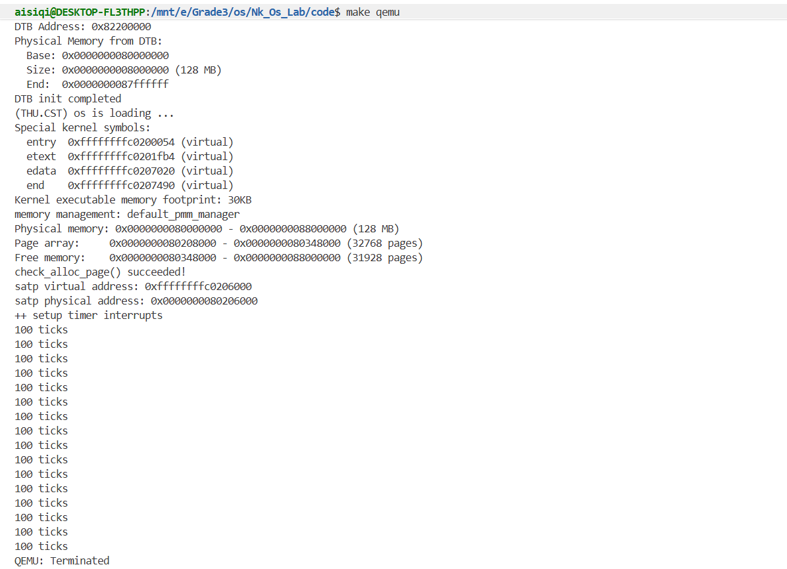
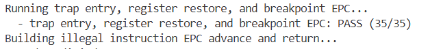
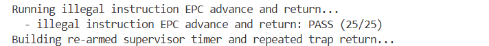
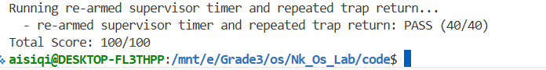

# 操作系统实验报告

## 实验基本信息

| 项目 | 内容 |
|------|------|
| **实验名称** | Lab 3: [中断处理机制] |
| **小组成员** | 2410796-艾思奇、2412806-阳雨洁 |
| **完成日期** | 2026-11-03 |

### 小组分工

练习如何分工？

| 成员 | 负责的练习/模块 |
|------|----------------|
| 2410796-艾思奇 | [模块二] |
| 2412806-阳雨洁 | [模块一] |

---

## 一、实验目的

<!-- 说明本次实验的主要目标和预期成果 -->

本实验的主要目的是：

1. [理解 RISC-V 的中断/异常机制、特权级划分与相关 CSR 寄存器]
2. [理解中断前后上下文环境的保存与恢复方法，掌握 trapframe 的数据布局]
3. [掌握中断入口点、C 语言处理函数与中断返回之间的衔接流程]
4. [为后续实现时钟中断、断点异常等具体中断处理打下基础]

---

## 二、实验环境

你们使用的 AI 工具

| 成员 | AI 编程工具 | 底层模型 | 备注 |
|------|------------|---------|------|
| 2410796-艾思奇 | vscode的codex插件 | [DeepSeek-V4-Flash] | 无 |
| 2412806-阳雨洁 | vscode的claude插件 | [DeepSeek-V4-Flash] | 无 |

**说明：**
- **AI 编程工具**：指具体使用的终端工具、编辑器插件、桌面应用或浏览器界面
- **底层模型**：指该工具使用的大语言模型及版本

---

## 三、实验整体逻辑分析

### 2.1 本章节的逻辑主线

- 本章实验的核心主题是操作系统的中断处理机制。操作系统作为计算机系统的监管者，必须能够对系统状态的突发变化（程序异常、外设请求、时钟到期等）及时做出响应：暂停当前执行流，陷入内核处理，处理结束后再回到被打断的位置继续执行。

- 在 RISC-V 中，中断（interrupt）与异常（exception）统称为 Trap。中断是异步事件，由外部设备或时钟触发；异常是同步事件，由当前指令触发（如非法指令、缺页、`ecall`、`ebreak`）。中断处理需要更高权限，因此通常运行在 S 模式（OpenSBI 等 M 模式固件已完成中断委托），内核通过 `stvec` 指定 Trap 入口，通过 `sepc`、`scause`、`stval`、`sstatus` 等 CSR 获知现场并完成返回。

- 本章要解决的核心问题是：Trap 发生时如何保存被打断程序的完整上下文，如何把上下文交给 C 语言函数处理，以及处理完成后如何原样恢复上下文并通过 `sret` 返回。本实验用一个 `struct trapframe` 描述保存的寄存器布局，并用 `trapentry.S` 中的汇编代码完成“保存上下文 → 调用 `trap()` → 恢复上下文 → `sret`”的闭环。时钟中断、断点异常等具体处理则位于 `trap.c` 中。

### 2.2 功能的逐步实现

本章实验的推进顺序是先从 Trap 的硬件机制过渡到软件入口，再进入具体中断的分类处理，具体步骤如下：

    0. 前置工作：补齐 Lab2 的物理内存管理代码（page_init、Best-Fit 等）

        做了什么：将 Lab2 中的 page_init() 以及 best_fit_pmm.c 的分配器实现原样补充到 Lab3 工程中，使 pmm_init() 能完成物理内存探测、Page 描述符初始化与空闲页注册。

        为什么先做这个：Lab3 的时钟中断、后续实验的内存管理都建立在可用的物理内存管理之上，且 Lab3 框架中保留的 default_pmm.c 已经是 Lab2 的完成版本，补齐其余部分是为了保证工程处于与 Lab2 一致的可用状态。

    1. 理解 RISC-V 的 Trap 机制与相关寄存器

        做了什么：学习 stvec、sepc、scause、stval、sstatus 的作用，理解 U/S/M 三种特权级以及硬件在陷入 S 模式时自动完成的操作（保存 sepc、写入 scause/stval、SIE→SPIE 并清零 SIE、SPP 记录来源特权级、PC←stvec）。

        为什么先理解这个：不弄清硬件自动做了什么、软件还需要做什么，就无法正确编写 Trap 入口；上下文保存/恢复的每一项都必须与硬件行为对应。

    2. 实现 Trap 入口与上下文保存/恢复（功能模块一：trapentry.S）

        做了什么：在已有 SAVE_ALL 的基础上实现 RESTORE_ALL 宏，并在 __alltraps 中把当前 Trap frame 地址按调用约定放入 a0、调用 trap()，返回后进入 __trapret，由 RESTORE_ALL 恢复上下文并执行 sret。

        为什么接着实现这个：这是所有中断处理的公共入口。没有正确的上下文保存与恢复，任何具体中断处理程序都无法安全运行；该模块也是模块二（trap.c 中的分发与处理）能够被调用的前提。

    3. 实现中断分发与具体中断处理（功能模块二：trap.c）

        做了什么：实现 trap_dispatch() 对中断/异常的分类，实现 interrupt_handler()（时钟中断、累加 ticks、设置下一次时钟事件）与 exception_handler()（断点异常等），并完成 idt_init() 中 stvec 的设置。

        为什么然后实现这个：模块一只负责“进得来、回得去”，模块二才决定“进来之后做什么”。时钟中断用于验证整个 Trap 闭环，断点异常用于验证异常路径。

    4. 理解中断的关闭与开启

        做了什么：理解 sstatus.SIE 的保存与恢复，以及 local_intr_save/local_intr_restore 在物理内存管理等临界区中的作用。

        为什么最后实现这个：中断机制完整可用之后，才能在需要原子性的关键操作中安全地屏蔽和恢复中断。

---

## 四、实验内容与实现

<!-- 
说明：本部分按照 exercises 文档中的练习顺序组织
每个功能模块或者练习中可能包含多项任务，请根据实际情况调整
-->

### 功能模块一：[Trap 入口与上下文保存/恢复]

**负责人：** [2412806-阳雨洁]

#### 模块功能描述

**需要实现/修改的函数/宏：**

```asm
.macro RESTORE_ALL
__alltraps
```

**功能说明：**

本模块负责 Trap 入口处的上下文切换，是中断处理机制能够“进得来、回得去”的基础。框架已经提供 SAVE_ALL 与 `__trapret` 的骨架，需要补全的是 RESTORE_ALL 以及 `__alltraps` 中调用 C 处理函数的衔接代码。

    该模块在整个系统中的作用：

        保存现场：Trap 发生时硬件跳转到 stvec 指向的 __alltraps，SAVE_ALL 把被打断程序的所有通用寄存器（x0–x31）、sstatus、sepc、badvaddr（stval）、scause 保存到当前内核栈上，形成一个 struct trapframe。

        交给 C 处理：__alltraps 需要按 RISC-V 调用约定把 Trap frame 首地址放入 a0，调用 void trap(struct trapframe *tf)，由 trap.c 完成具体的中断/异常分发与处理。

        恢复现场：trap() 返回后进入 __trapret，RESTORE_ALL 按与 SAVE_ALL 一一对应的关系恢复寄存器和 CSR，最后执行 sret，回到被打断的执行流。

    需要特别处理的场景：

        x2(sp) 的特殊性：SAVE_ALL 先执行 csrw sscratch, sp 暂存原 sp，再下移内核栈；随后通过 csrrw s0, sscratch, x0 把原 sp 取出并存入 Trap frame 的 2*REGBYTES 槽。因此 RESTORE_ALL 不能把 sp 当作普通寄存器提前恢复，必须在其他寄存器都恢复完之后最后恢复 x2，否则会丢失 Trap frame 基址。

        sret 的前置状态：sstatus 与 sepc 必须在执行 sret 前恢复，否则返回地址或中断使能状态错误；恢复顺序上先写 CSR，再恢复通用寄存器，最后恢复 sp。

        x0 的处理：x0 恒为 0，SAVE_ALL 虽然保存了它，但 RESTORE_ALL 不能也不需要恢复 x0（写 x0 无效果）。

        调用约定：trap() 的第一个参数通过 a0 传递；__alltraps 在 jal trap 前执行 move a0, sp；trap() 返回后 sp 应保持不变，直接落入 __trapret。

    与其他模块的交互关系：

        上游：idt_init() 将 stvec 设置为 __alltraps 的地址，Trap 发生时硬件据此跳转。

        下游：通过 a0 把 struct trapframe * 交给 trap.c 的 trap()，由 trap_dispatch()、interrupt_handler()、exception_handler() 处理；处理结果直接写回 Trap frame，由本模块恢复。

        数据布局：严格依赖 struct trapframe（gpr[32] + status + epc + badvaddr + cause，共 36*REGBYTES）与 SAVE_ALL 中实际的偏移，不得臆造顺序。

#### 最终提示词

以下是经过迭代优化后，最终成功实现该功能的提示词：

````markdown

[PROMPT]
**任务**：修改文件 `kern/trap/trapentry.S`，实现或完善 `RESTORE_ALL` 与 `__alltraps`。`RESTORE_ALL` 负责根据已有 `SAVE_ALL` 建立的 Trap frame 恢复被打断程序的处理器上下文；`__alltraps` 负责在 Trap 入口完成上下文保存后，按照 RISC-V 调用约定把当前 Trap frame 地址作为 `struct trapframe *` 参数传递给 C 语言函数 `void trap(struct trapframe *tf)`，并在 `trap()` 返回后进入 `__trapret`，最终通过 `sret` 返回原执行流。

**操作要求**：你必须在项目中修改实际文件 `kern/trap/trapentry.S`，保留文件中的现有代码，只在你需要补全或完善的 `RESTORE_ALL`、`__alltraps` 及其附近位置进行修改和补充。不要删除既有逻辑，不要修改无关文件，不要修改 `pmm.c`。必须先阅读并严格依据文件中已有的 `SAVE_ALL`、`struct trapframe` 定义、`__trapret` 以及 `trap()` 的函数签名进行实现；不得自行假设与实际 Trap frame 不一致的寄存器保存顺序、偏移或数据布局。不得修改 `SAVE_ALL`、`struct trapframe` 和 `trap()` 的函数签名。实现方式不限定为某一种固定汇编指令序列，但必须保证“Trap 进入 -> 上下文保存 -> C 语言处理 -> 上下文恢复 -> Trap 返回”闭环一致。

**输出要求**：直接进行文件操作，使用下面 [RELY]、[GUARANTEE]、[SPECIFICATION] 部分提供的信息，以工程真实代码为准，不要引入无关功能。

[RELY]

// 1. 相关文件与已有汇编接口

`kern/trap/trapentry.S` 中已提供或需要完善的汇编符号/宏包括：

SAVE_ALL      // 已提供：把 Trap 发生时的处理器状态保存到当前内核栈上的 Trap frame 中
__alltraps    // 需要完善：Trap 汇编入口，建立 Trap frame 并调用 trap(struct trapframe *tf)
__trapret     // 已提供：Trap 返回路径，最终执行 sret
RESTORE_ALL   // 需要实现/完善：从当前 Trap frame 恢复处理器上下文

// 2. C 语言接口与数据结构

struct trapframe;                  // 决定 SAVE_ALL 保存后的上下文数据布局
void trap(struct trapframe *tf);   // C 语言 Trap 处理函数，不得修改函数签名

// 3. RISC-V 体系结构与调用约定

- RISC-V 函数调用约定：第一个整型/指针参数通过 a0 传递。
- `__alltraps` 调用 `trap()` 前，必须把当前 Trap frame 的首地址按调用约定放入 a0。
- `trap()` 返回后，应进入 `__trapret`，由 `__trapret` 继续完成返回流程并执行 `sret`。
- Trap frame 的实际布局由 `struct trapframe` 和已有 `SAVE_ALL` 决定，不得臆造。
- 特别注意：`SAVE_ALL` 中对 x2(sp) 的处理方式与其他通用寄存器并不完全相同；`RESTORE_ALL` 不能简单地把所有寄存器按完全相同方式恢复，必须先以当前 Trap frame 基址完成其他必要恢复，最后安全恢复被打断程序的 sp，或采用与现有 SAVE_ALL 布局等价的正确方式。
- `RESTORE_ALL` 必须与 `SAVE_ALL` 的保存关系一一对应，不能破坏 `__trapret` 执行 `sret` 所需的返回状态。

[GUARANTEE]

必须实现或完善以下接口：

```asm
__alltraps
RESTORE_ALL
```

可以添加：
- 内部使用的汇编标签
- 必要的注释
- 与现有 `SAVE_ALL` 布局一致的内部宏或辅助代码片段

但不得：
- 修改 `SAVE_ALL`
- 修改 `struct trapframe`
- 修改 `void trap(struct trapframe *tf)` 的函数签名
- 修改 `__trapret` 既有的 `sret` 返回机制
- 引入与 Trap 上下文保存/恢复无关的功能

[SPECIFICATION]

## __alltraps
**Pre-Condition**：
- `SAVE_ALL` 已按现有 Trap frame 布局把 Trap 发生时的处理器状态保存到当前内核栈。
- 当前栈指针指向该 Trap frame。
- `trap(struct trapframe *tf)` 可被调用。
- `__trapret` 已存在，并负责最终 Trap 返回。

**Post-Condition**：
- `__alltraps` 在完成必要的 Trap 入口处理后，将当前 Trap frame 首地址按照 RISC-V 调用约定放入 `a0`。
- 调用 `trap(struct trapframe *tf)`。
- `trap()` 返回后，跳转进入 `__trapret`。
- 调用 `trap()` 过程中不得破坏后续 `RESTORE_ALL`/`__trapret` 恢复上下文所需的信息。

**Case 1**：正常 Trap 入口调用
- 触发条件：已存在有效 Trap frame，`trap()` 可调用。
- 执行行为：正确建立 `a0 = 当前 Trap frame 地址`，调用 `trap()`；返回后进入 `__trapret`。

**Case 2**：不得臆造 Trap frame 布局
- 触发条件：`SAVE_ALL` 或 `struct trapframe` 已有实际布局。
- 执行行为：必须以文件中真实保存顺序和偏移为准，不得按固定伪代码假设布局。

## RESTORE_ALL
**Pre-Condition**：
- 当前 `sp` 指向 `SAVE_ALL` 建立的 Trap frame。
- Trap frame 中各寄存器保存位置由已有 `SAVE_ALL` 和 `struct trapframe` 决定。

**Post-Condition**：
- 按与 `SAVE_ALL` 对应的关系恢复 Trap frame 中保存的处理器上下文。
- 对 x2(sp) 进行特殊处理：不得在仍需要 Trap frame 基址时把 sp 当普通寄存器提前恢复；应保证最终恢复到被打断程序的 sp，或采用与现有布局等价的正确方式。
- 不破坏 `__trapret` 执行 `sret` 所需的状态。
- 恢复完成后，控制流可进入 `__trapret` 并最终通过 `sret` 返回原执行流。

**Case 1**：正常上下文恢复
- 触发条件：Trap frame 布局与 `SAVE_ALL` 一致。
- 执行行为：正确恢复已保存寄存器；x2(sp) 按特殊方式安全恢复；不得破坏返回路径。

**Case 2**：布局依赖不明确
- 触发条件：无法从现有 `SAVE_ALL`、`struct trapframe` 或文件骨架确定某一偏移/顺序。
- 执行行为：不得猜测硬编码；应以工程真实代码为准补全，并通过注释明确依赖关系；不得引入无关功能。

**Case 3**：不得修改既有接口
- 触发条件：实现 `RESTORE_ALL` 和 `__alltraps` 时涉及 `SAVE_ALL`、`struct trapframe`、`trap()` 或 `__trapret`。
- 执行行为：保持 `SAVE_ALL`、`struct trapframe`、`trap()` 签名和 `__trapret` 既有返回机制不变，只补全本模块要求的上下文恢复与 Trap 入口调用关系。

````

#### 实现迭代过程

本模块的实现经历了 [1] 次迭代，过程如下：

---

##### 第一次迭代

由于 [SPECIFICATION] 已明确要求“以工程真实代码为准”，实现前先阅读了 `SAVE_ALL`、`struct trapframe`（`kern/trap/trap.h`）、`trap()`（`kern/trap/trap.c`）与 `__trapret`，确认了 Trap frame 的实际布局：x0–x31 依次位于 `0*REGBYTES`–`31*REGBYTES`，其中 x2 槽保存的是被打断程序的原始 sp（SAVE_ALL 通过 `sscratch` 中转）；`status`、`epc`、`badvaddr`、`cause` 位于 `32*REGBYTES`–`35*REGBYTES`。

据此实现：

- `RESTORE_ALL`：先从 `32*REGBYTES`、`33*REGBYTES` 恢复 sstatus 与 sepc（`csrw`），再按 SAVE_ALL 的对应关系恢复 x1、x3–x31，最后单独 `LOAD x2, 2*REGBYTES(sp)`。
- `__alltraps`：`SAVE_ALL` 之后执行 `move a0, sp`、`jal trap`，返回后自然落入 `__trapret`，由 `RESTORE_ALL` 与 `sret` 完成返回。

**遇到的问题：**

- 问题一：最初考虑按 x0–x31 的直觉顺序统一恢复。但 `sp` 本身用于访问 Trap frame，若在恢复过程中提前改写 sp，后续所有 `LOAD` 的基址都会失效。
- 原因分析：SAVE_ALL 把原始 sp 存放在 x2 槽，而不是在恢复时继续复用；因此恢复 sp 必须是最后一步。

- 问题二：本机工具链（GCC 15 / binutils）不再识别 `SAVE_ALL` 中使用的旧 CSR 名称 `sbadaddr`，直接 `make` 会在该行报 `unknown CSR 'sbadaddr'`。
- 原因分析：`sbadaddr` 是旧版 privileged ISA 中 `stval` 的别名，对应同一个 CSR（0x143），新版汇编器只接受 `stval`。这是框架既有代码与工具链版本之间的兼容问题，并非本模块实现错误；同时任务约束明确禁止修改 `SAVE_ALL`。

**问题解决策略：**

- 针对问题一：将 `LOAD x2, 2*REGBYTES(sp)` 放在所有通用寄存器和 CSR 恢复之后，并在代码中用注释说明原因。
- 针对问题二：不修改工程中的 `SAVE_ALL`；为验证本模块的语法与最终指令序列，将文件复制到临时目录，仅把 `sbadaddr` 替换为等价的 `stval` 后用 Makefile 的原始编译参数汇编，并检查反汇编结果。

**最终结果：**

经过 [1] 次迭代，该模块最终：
- 汇编验证通过（临时副本中 `sbadaddr`→`stval` 等价替换；`RESTORE_ALL`、`__alltraps` 语法正确）
- 反汇编确认 `__alltraps` 先 `mv a0, sp` 再 `jal trap`；`__trapret` 依次恢复 sstatus/sepc、各通用寄存器，最后 `ld sp,16(sp)` 并 `sret`


**关键改进点总结：**
1. [严格以 SAVE_ALL 的实际布局为准：所有偏移、寄存器顺序均与文件中真实的保存顺序一一对应，没有按伪代码臆造布局。]
2. [sp 特殊处理：明确 x2 槽保存的是原始 sp，恢复必须放在最后，避免提前破坏 Trap frame 基址。]
3. [接口零改动：SAVE_ALL、struct trapframe、trap() 签名与 __trapret 机制均未修改，只补全上下文恢复与入口调用关系。]
4. [可验证性：在不能改动 SAVE_ALL 的前提下，用临时副本完成汇编与反汇编验证，确认指令序列符合预期。]

### 功能模块二：[中断分发与中断处理]

**负责人：** [2410796-艾思奇]

#### 模块功能描述

**需要实现/修改的函数/宏：**

```c
void interrupt_handler(struct trapframe *tf);
void exception_handler(struct trapframe *tf);
```

**功能说明：**

本模块负责处理经过 Trap 入口保存并传递到 C 语言的 Trap 上下文，是中断处理机制中“进来之后做什么”的部分。已有的 `trap_dispatch()` 根据 `scause` 最高位完成中断与异常的第一级分类：最高位为 1 时调用 `interrupt_handler()`，最高位为 0 时调用 `exception_handler()`。两个处理函数都接收当前 `struct trapframe *`，并在完成处理后返回到统一路径，由 `__trapret`、`RESTORE_ALL` 和 `sret` 恢复被打断的执行流。

`interrupt_handler()` 负责处理异步中断。对于 S 模式时钟中断，函数先屏蔽 `tf->cause` 的最高位得到实际中断原因，再增加全局 `ticks`，通过 `clock_set_next_event()` 设置下一次时钟事件，并在每累计 `TICK_NUM == 100` 次 tick 时调用已有的 `print_ticks()`。时钟事件必须持续重装，否则系统只会收到一次时钟中断。对于 S 模式软件中断，输出规定提示；对于无法识别的中断，输出原因号并调用 `print_trapframe(tf)` 保存完整现场用于调试。

`exception_handler()` 负责处理同步异常。断点和非法指令异常都会输出异常地址，并根据故障指令的最低两位判断其是 2 字节压缩指令还是 4 字节标准指令，再相应推进 `tf->epc`。由于 `RESTORE_ALL` 会从 Trap frame 中恢复 `sepc`，处理函数必须修改 `tf->epc` 而不是直接写 `sepc`。其他未要求具体处理的异常则通过 `print_trapframe(tf)` 输出现场后返回，避免在兜底路径中阻塞统一的 Trap 返回流程。

本模块与模块一共同构成完整闭环：

    时钟中断或异常发生
        -> __alltraps 保存 Trap frame
        -> trap(tf)
        -> trap_dispatch(tf) 分类
        -> interrupt_handler(tf) 或 exception_handler(tf)
        -> trap() 返回
        -> __trapret、RESTORE_ALL
        -> sret 返回被打断的执行流

实现过程中特别以当前工程实际代码和评分脚本为准。指导书正文提到了 `SHUTDOWN_AFTER` 与系统关机逻辑，但当前工程没有定义 `SHUTDOWN_AFTER`，评分测试也要求时钟中断持续处理到 `ticks=200`，因此本模块没有引入关机分支，避免使用未定义标识符或提前终止内核。

#### 最终提示词

以下是用于实现本模块的最终提示词：

````markdown
[PROMPT]
**任务**：在工作区的 `Nk_Os_Lab/code` 项目中修改文件 `kern/trap/trap.c`，实现中断与异常处理功能模块中的 `interrupt_handler(struct trapframe *tf)` 和 `exception_handler(struct trapframe *tf)` 两个函数。这两个函数由现有的 `trap_dispatch()` 调用，分别负责处理 RISC-V Trap 中的中断和同步异常。

**操作要求**：你必须在项目中修改实际文件，而不是仅展示代码。只修改 `kern/trap/trap.c`，将实现插入到 `//lab3 function2 YOUR CODE` 标记附近，并确保两个函数的定义位于 `trap_dispatch()` 调用它们之前，避免隐式函数声明。保留文件中已有的 `print_ticks()`、`idt_init()`、`print_trapframe()`、`print_regs()`、`trap_dispatch()` 和 `trap()` 等既有代码及其行为，不要删除或重写无关逻辑，不要修改 `trapentry.S`、`trap.h`、`clock.c`、`init.c` 或测试与评分脚本。允许添加仅在本文件内部使用的 `static` 辅助函数。

**输出要求**：直接进行文件操作。严格使用下面 `[RELY]` 中与当前工程一致的真实宏、数据结构和函数；不要引入未定义的标识符，不要引入与当前 Lab3 无关的系统调用、调度或关机功能。实现后应能通过编译，并使时钟中断、软件中断回退、未知中断回退、断点异常、非法指令异常和未知异常回退能够正确返回到统一的 Trap 返回流程。

[RELY]

// 宏定义
```c
#define TICK_NUM 100

#define IRQ_S_SOFT   1
#define IRQ_S_TIMER  5

#define CAUSE_ILLEGAL_INSTRUCTION 0x2
#define CAUSE_BREAKPOINT          0x3
```

RISC-V 的 `scause` 最高位为 1 表示该 Trap 是中断，低 63 位表示中断原因；最高位为 0 表示同步异常。`trap_dispatch()` 已使用 `(intptr_t)tf->cause < 0` 判断中断，因此传给 `interrupt_handler()` 的 `tf->cause` 通常包含第 63 位。处理中断原因时应先屏蔽第 63 位，不能直接用带有高位标志的完整值进行 `switch`。

// 数据结构
```c
struct trapframe {
    struct pushregs gpr;
    uintptr_t status;
    uintptr_t epc;
    uintptr_t badvaddr;
    uintptr_t cause;
};
```

其中：

- `tf->cause`：当前异常或中断的原因。
- `tf->epc`：Trap 返回后将恢复到的程序计数器。处理同步异常时，应通过修改 `tf->epc` 跳过已经触发异常的指令。
- `tf->status`、`tf->badvaddr` 和 `tf->gpr`：保存的 Trap 上下文，本任务只读使用。

```c
extern volatile size_t ticks;
```

`ticks` 已由 `clock_init()` 初始化为 0，并在每次 S 模式时钟中断发生时递增。

// 可用函数
```c
static void print_ticks(void);
void print_trapframe(struct trapframe *tf);
void clock_set_next_event(void);
int cprintf(const char *fmt, ...);

static inline void trap_dispatch(struct trapframe *tf);
```

- `print_ticks()` 已实现，每调用一次输出 `100 ticks`。
- `print_trapframe(tf)` 已实现，用于输出完整 Trap frame。
- `clock_set_next_event()` 已实现，用于设置下一次时钟事件。
- `trap_dispatch()` 已根据 `tf->cause` 的最高位选择调用 `interrupt_handler()` 或 `exception_handler()`。
- `cprintf()` 支持 `%d`、`%x`、`%lx` 和 `%s` 等格式。

当前工程中没有定义 `SHUTDOWN_AFTER`，当前 Lab3 评分要求也要求持续处理时钟中断直到至少 200 个 tick，因此本任务不要引用 `SHUTDOWN_AFTER`，不要在本模块中调用 `sbi_shutdown()`。

[GUARANTEE]

必须实现或修改的接口：
```c
void interrupt_handler(struct trapframe *tf);
void exception_handler(struct trapframe *tf);
```

这两个函数必须具有外部链接，不能声明为 `static`，因为其他编译单元可能引用它们。函数签名不得修改。

你可以根据需要添加：
- 辅助函数，例如将中断原因与第 63 位分离、根据指令编码计算指令长度的函数；辅助函数建议设为 `static`
- 本文件内部使用的宏定义
- 本文件内部使用的静态变量

[SPECIFICATION]

## interrupt_handler

**Pre-Condition**:
- `tf` 是有效的 `struct trapframe *`。
- 该函数由 `trap_dispatch()` 在识别到中断时调用；此时 `tf->cause` 通常包含第 63 位中断标志。
- 某些测试或内部调用也可能直接传入只包含低 63 位原因码的 `tf->cause`，实现应能正确提取中断原因。

**Post-Condition**:
- 根据屏蔽第 63 位后的中断原因完成相应处理，并返回到 `trap_dispatch()` 和后续的 Trap 返回流程。
- 时钟中断路径中，每次调用都必须使 `ticks` 增加 1，并保证下一次时钟事件已经被设置。
- 除 `ticks` 的递增和必要的下一次时钟事件设置外，不得修改 `tf` 中保存的上下文。
- 不得在处理函数中主动开启全局中断，不得修改 `trap_dispatch()` 的分发逻辑，也不得直接调用 `sret`。

**Case 1**:
- 当前中断原因是 `IRQ_S_TIMER` 时，执行一次时钟 tick 统计，并设置下一次时钟事件；每次 `ticks` 达到 `TICK_NUM` 的正整数倍时调用已有的 `print_ticks()`。下一次时钟事件必须在函数返回前设置，不能只在第一次中断时设置。处理结束后正常返回，不调用关机接口，不在函数内主动开启中断。

**Case 2**:
- 当前中断原因是 `IRQ_S_SOFT` 时，仅输出一行完全匹配 `Supervisor software interrupt\n` 的提示，不增加 `ticks`，不重新设置时钟事件，然后正常返回。

**Case 3**:
- 当前中断原因不是 `IRQ_S_TIMER` 或 `IRQ_S_SOFT` 时，先输出一行格式为 `Unknown interrupt: cause %d\n` 的信息，其中 `%d` 使用屏蔽最高位后的原因码；随后调用已有的 `print_trapframe(tf)` 输出完整 Trap frame，并正常返回，不得在该分支中 `panic` 或进入死循环。

**Requirements**:
- 中断原因必须通过与 `0x7fffffffffffffff` 等价的 64 位掩码或等价的位操作得到，不能把 `0x8000000000000005` 直接当作中断原因 5 使用。
- 每次 S 模式时钟中断都必须调用 `clock_set_next_event()`，确保中断能够持续触发。
- 时钟统计应基于全局 `ticks`；不得自行创建另一套独立计数变量。
- 两个处理函数必须能够在正常处理后返回，使 `trap()` 返回 `__trapret`，最终由 `RESTORE_ALL` 和 `sret` 完成返回。
- 不得修改 `print_ticks()` 的既有行为，也不得引用当前工程中未定义的 `SHUTDOWN_AFTER`。

## exception_handler

**Pre-Condition**:
- `tf` 是有效的 `struct trapframe *`。
- 该函数由 `trap_dispatch()` 在识别到同步异常时调用。
- `tf->cause` 的最高位为 0，低 63 位保存同步异常原因。
- `tf->epc` 保存触发异常的指令地址。

**Post-Condition**:
- 根据 `tf->cause` 完成异常分类和处理，并返回统一的 Trap 返回流程。
- 对于断点和非法指令异常，`tf->epc` 必须推进到异常指令之后，避免 `sret` 后再次执行同一条指令。
- 对于其他异常，输出当前 Trap frame，但不得修改函数签名或在默认分支中终止系统。

**Case 1**:
- 当前异常原因是 `CAUSE_BREAKPOINT` 时，先输出一行包含 `Breakpoint at 0x` 和原始 `tf->epc` 的提示，再根据当前指令的 2 字节或 4 字节编码将 `tf->epc` 推进相应长度。输出地址后不得再次原样返回同一指令。

**Case 2**:
- 当前异常原因是 `CAUSE_ILLEGAL_INSTRUCTION` 时，先输出一行包含 `Illegal instruction at 0x` 和原始 `tf->epc` 的提示，再根据当前非法指令的 2 字节或 4 字节编码将 `tf->epc` 推进相应长度。当前评分代码使用的是 4 字节非法指令，但实现应根据指令低两位编码判断实际长度，不要不加判断地假定所有异常都固定推进 4 字节。

**Case 3**:
- 当前异常原因不是 `CAUSE_BREAKPOINT` 或 `CAUSE_ILLEGAL_INSTRUCTION` 时，调用已有的 `print_trapframe(tf)` 输出完整 Trap frame，并正常返回。该分支不得输出后继续执行出错指令，不得直接修改 `sepc` CSR，也不得通过 `panic` 或死循环阻止测试继续运行。

**Requirements**:
- 必须通过修改 `tf->epc` 调整返回位置，不能直接写 `sepc`；后续 `RESTORE_ALL` 会根据 Trap frame 中的 `epc` 恢复 `sepc`。
- 指令长度判断应遵循 RISC-V 指令编码规则：根据故障指令最低两位判断是否为 2 字节压缩指令；非法指令和断点指令的具体处理应使用实际长度推进。
- 不得修改 `tf->cause`。
- 不得修改 `trap_dispatch()`、`trap()`、Trap frame 布局或汇编入口。
- 未知异常回退分支必须调用 `print_trapframe(tf)` 后返回，以便评分能够检查未知异常的 `cause 0x00000014` 输出。
- 两个处理函数都必须能够在正常处理后返回，使 `trap()` 返回 `__trapret`，最终由 `RESTORE_ALL` 和 `sret` 完成返回。
````

#### 实现迭代过程

本模块的实现经历了 [1] 次有效编码迭代，过程如下：

---

##### 第一次迭代

实现前先阅读了 `kern/trap/trap.c`、`kern/trap/trap.h`、`kern/driver/clock.c`、`libs/riscv.h` 和评分测试，确认了以下事实：

- `trap_dispatch()` 已经根据 `tf->cause` 的最高位完成中断与异常分类，本模块只需实现两个具体处理函数。
- 时钟中断原因需要屏蔽最高位后才能与 `IRQ_S_TIMER` 比较；软件中断和未知中断测试也可能直接传入低 63 位原因码。
- 断点和非法指令都属于同步异常，若不修改 `tf->epc`，`sret` 会返回同一条异常指令并形成循环。
- 现有工程没有定义 `SHUTDOWN_AFTER`，评分脚本要求持续处理到 `ticks=200`，因此不能机械照搬指导书中提到的关机逻辑。

**遇到的问题：**

- 问题一：`scause` 的第 63 位是中断标志，时钟中断的完整值类似 `0x8000000000000005`，不能直接与宏 `IRQ_S_TIMER == 5` 比较。
- 问题二：指导书提到达到 `SHUTDOWN_AFTER` 后关机，但当前工程既没有该宏，评分测试又要求在时钟中断持续返回后达到 200 tick。
- 问题三：异常返回必须跳过故障指令，RISC-V 同时存在 2 字节压缩指令和 4 字节标准指令，不能简单假定所有异常都固定加 4。
- 问题四：异常处理不能直接修改 `sepc`，因为后续 `RESTORE_ALL` 会用 Trap frame 中的 `tf->epc` 覆盖该 CSR。

**问题解决策略：**

- 针对问题一：在 `interrupt_handler()` 中先通过 `tf->cause & ~((uintptr_t)1 << 63)` 提取低 63 位原因，再使用局部变量进行 `switch`；不修改原 Trap frame 中的 `cause`。
- 针对问题二：以当前工程代码和评分脚本为准，不引用未定义的 `SHUTDOWN_AFTER`，也不调用 `sbi_shutdown()`；时钟中断每次只负责计数、重装下一次事件和按周期打印。
- 针对问题三：增加静态辅助函数 `instruction_length()`，读取故障指令并检查最低两位；最低两位为 `0b11` 时按 4 字节处理，否则按 2 字节压缩指令处理。
- 针对问题四：断点和非法指令分支只修改 `tf->epc`，让后续汇编返回路径统一完成 CSR 恢复。
- 对于未知中断：先打印屏蔽高位后的原因号，再调用 `print_trapframe(tf)`；对于未知异常：直接调用 `print_trapframe(tf)`。两条兜底路径都正常返回，不使用 `panic`。

**最终结果：**

首次实现完成后，时钟中断、软件中断、未知中断、断点、非法指令和未知异常路径均符合要求。运行 `make grade` 的结果为：

```text
trap entry, register restore, and breakpoint EPC: PASS (35/35)
illegal instruction EPC advance and return: PASS (25/25)
re-armed supervisor timer and repeated trap return: PASS (40/40)
Total Score: 100/100
```

该结果说明：

- Trap 入口能够正确保存和恢复上下文，断点处理后可以返回并继续执行。
- 非法指令能够被识别，EPC 正确前移，不会重复执行故障指令。
- 软件中断、未知中断和未知异常都能进入对应回退分支并正常返回。
- 时钟中断能够持续重装，控制台按周期输出 `100 ticks`，最终达到 `ticks=200`。

**关键改进点总结：**

1. 严格按照 `scause` 的位含义提取中断原因，而不是直接比较带有最高位的完整值。
2. 将“指令长度判断”独立为静态辅助函数，避免把异常恢复逻辑固定为 4 字节偏移。
3. 通过修改 `tf->epc` 调整同步异常的返回地址，与现有 `RESTORE_ALL` 恢复 `sepc` 的机制保持一致。
4. 所有未知类型都走可返回的打印兜底路径，不使用会阻塞测试的 `panic`。
5. 以当前工程实际定义和评分要求为准，没有引入未定义的 `SHUTDOWN_AFTER` 或无关的关机、调度功能。

---

## 五、测试与验证

<!-- 根据该实验的具体情况，提供完整的测试运行截图，应包含：
- 编译及运行成功的输出（make qemu），可能有多个
- 测试通过的结果（make grade），只有一个
-->


#### 1. 汇编验证

将 `trapentry.S` 复制到临时目录，仅将框架既有 `SAVE_ALL` 中的 `sbadaddr` 替换为等价的 `stval`（CSR 0x143），使用 Makefile 的原始编译参数汇编：

```text
riscv64-unknown-elf-gcc -Ikern/trap/ -mcmodel=medany ... -c trapentry.S -o trapentry.o
ASSEMBLE OK
```

#### 2. 反汇编检查

`objdump` 确认关键指令序列：

```text
__alltraps:
    ...
    mv      a0,sp
    jal     trap
__trapret:
    ld      s1,256(sp)
    csrw    sstatus,s1
    ld      s2,264(sp)
    csrw    sepc,s2
    ...
    ld      sp,16(sp)      # x2 最后恢复
    sret
```

说明 `SAVE_ALL -> 传参 -> trap() -> RESTORE_ALL -> sret` 的闭环在指令层面是一致的。

#### 3. 运行截图展示









---

## 六、实验总结与收获

### 对操作系统的理解

本次实验把操作系统中“中断/异常”这一抽象落实到了具体的汇编与数据结构上。RISC-V 硬件在 Trap 发生时只自动保存少量信息（sepc、scause、stval、sstatus.SPIE/SPP 等）并跳转到 stvec，剩下的通用寄存器上下文必须由软件自己保存；而 `struct trapframe` 和 `SAVE_ALL`/`RESTORE_ALL` 正是软件约定的“现场快照”格式。实现 RESTORE_ALL 的关键不在于指令多少，而在于严格对应 SAVE_ALL 的实际布局，尤其是 x2(sp) 必须最后恢复这一点，否则 Trap frame 基址会被提前破坏。`__alltraps` 则体现了汇编入口与 C 处理函数之间的分工：汇编只负责保存现场、按调用约定传参和恢复现场，具体的中断语义交由 `trap()` 处理。


### AI 协作开发的经验

本次实验说明，向 AI 描述底层汇编任务时，“不要臆造布局、必须以现有代码为准”这类约束非常重要。提示词中给出前置条件、后置条件以及不得修改的接口（SAVE_ALL、trapframe、trap 签名、`__trapret`），使生成结果被限制在必要范围内，没有引入额外功能。同时，AI 生成的代码仍需人工核对：例如 sp 的恢复顺序、`sret` 前必须恢复 sstatus/sepc 等细节，需要通过阅读 SAVE_ALL 和反汇编来确认。遇到工具链与旧 CSR 名称不兼容的问题时，也更适合先区分“框架既有问题”与“本次实现问题”，在不违反实验约束的前提下用临时副本完成验证，而不是直接改动被禁止修改的代码。
